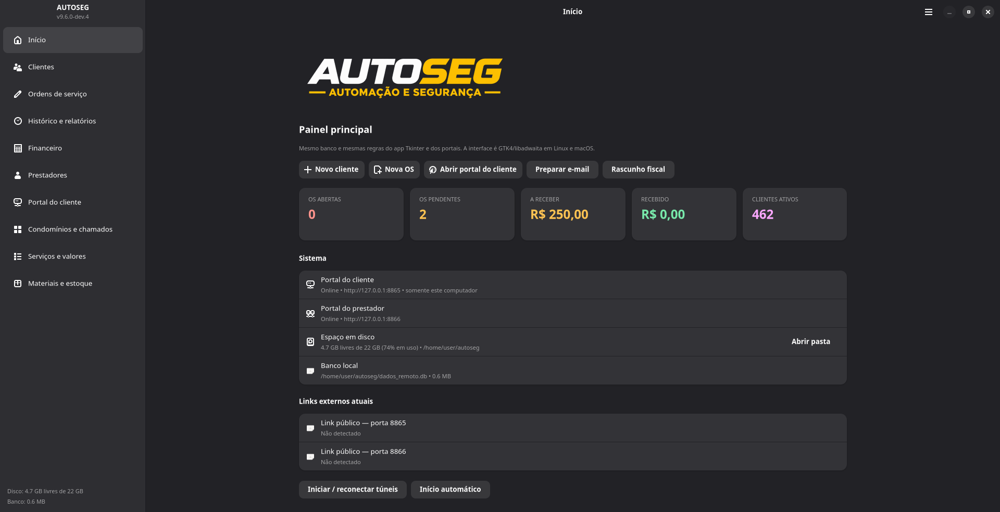

# AUTOSEG GTK4/libadwaita — Linux e macOS

Este documento descreve a interface desktop nova (`gtk_app.py`), que usa o
**mesmo backend**, o **mesmo banco SQLite** e as **mesmas regras** do app
Tkinter e dos portais. Não é um fork: nenhum módulo de regra de negócio foi
duplicado para Linux ou macOS.

- Branch de desenvolvimento: `develop`
- Versão lida de `versao.json`: `9.6.0-dev.4`
- Backend compartilhado: `banco.py`, `cadastros_v9.py`, `prestadores_ext.py`,
  `fluxo_os.py`, `atendimento_os.py`, `estoque_materiais.py`,
  `catalogo_servicos.py`, `portal_negocios.py`, `servidor_web.py`,
  `portal_prestador.py`
- Frontends:
  - `app.py` — Tkinter legado (continua funcionando)
  - `gtk_app.py` — GTK4 + libadwaita (novo)



## Princípio de convivência

Os dois frontends podem ser abertos na mesma máquina, mas não ao mesmo tempo
na mesma pasta de dados: os portais usam portas fixas. O banco é o mesmo e o
schema é aditivo. Recursos novos entram no backend primeiro e ficam
disponíveis para Tkinter, GTK, portal do cliente e portal do prestador.

Variáveis úteis:

| Variável | Efeito |
|---|---|
| `AUTOSEG_BASE` | pasta de dados (banco, anexos, PDFs, rascunhos). Padrão: pasta do projeto |
| `GESTAO_BANCO` | caminho explícito do SQLite; tem prioridade sobre `AUTOSEG_BASE` |
| `CLIENTE_PORT` / `CLIENTE_BIND` | portal do cliente (padrão 8765 / 127.0.0.1). Use `CLIENTE_BIND=0.0.0.0` para a rede local |
| `PRESTADOR_PORT` / `PRESTADOR_BIND` | portal do prestador (padrão 8766 / 127.0.0.1). Use `PRESTADOR_BIND=0.0.0.0` para a rede local |
| `AUTOSEG_DEV=1` | portas 8865/8866, banco de teste e túneis de desenvolvimento |
| `GTK_USE_PORTAL=0` | evita a espera de ~25 s do portal XDG em ambientes sem sessão gráfica completa |
| `AUTOSEG_SMOKE=1` | abre e fecha a janela em 3 s; usado em teste de fumaça |

## Trabalho em equipe Linux + macOS

- O código é um só: `develop` (ou uma branch de feature no mesmo repositório).
  Não há fork de backend nem cópia de regras por sistema.
- Cada desenvolvedor usa um banco local. **Não** coloque o mesmo `dados.db`
  em pasta de rede/Dropbox/iCloud: SQLite com WAL não é seguro para escrita
  concorrente entre máquinas.
- Para trocar massa de teste, use o gerador fictício
  `CRIAR_CADASTROS_FICTICIOS_DEV.py`; ele é bloqueado fora de `dados_teste/`.
- O macOS usa `AUTOSEG_BASE` (padrão `~/gestaoservicos_MAIN`); o Linux pode
  usar a pasta do projeto ou outra pasta indicada pela mesma variável.

## Linux

### Dependências

Requisitos mínimos: GTK >= 4.10, libadwaita >= 1.5 (por causa de `Adw.Dialog`/`Adw.AlertDialog`) e PyGObject >= 3.42.

Em Ubuntu/Debian com GTK4 e libadwaita instalados:

```bash
sudo apt install python3-gi gir1.2-gtk-4.0 gir1.2-adw-1 \
  libgtk-4-1 libadwaita-1-0 python3-pil
```

O `reportlab` é usado apenas para gerar PDFs. Neste ambiente ele foi extraído
do pacote `python3-reportlab` para `.vendor/` (sem `sudo`). Em uma instalação
normal:

```bash
python3 -m pip install --user 'reportlab>=4.2,<5' 'pillow>=10,<13' 'PyYAML>=6,<7'
```

O `gtk_comum.py` adiciona `.vendor/usr/lib/python3/dist-packages` ao
`sys.path` quando essa pasta existe.

### Executar direto

```bash
./INICIAR_AUTOSEG_GTK.sh
```

### Executar no display da VM, sem Xvfb/Xwayland

```bash
./ABRIR_NO_DRM.sh
```

Esse é o caminho nativo: `cage` usa DRM (`/dev/dri/card1`), o VT ativo e
libinput (`WLR_BACKENDS=drm,libinput`); o `gtk_app.py` roda como cliente
**Wayland**. Não há Xvfb nem
Xwayland no meio. O script usa `sudo` para aplicar ACLs em DRM, VT, seatd e
dispositivos de entrada; em uma VM isso é aceitável, mas as ACLs podem ser
perdidas após reiniciar.

Para conferir que o app está em Wayland:

```bash
# dentro de outro terminal, com o Cage em execução
ls -l "$XDG_RUNTIME_DIR"/wayland-*
grim /tmp/autoseg.png   # screenshot Wayland nativo
```

> O `grim` é opcional; foi usado apenas para validar o display.

### Teste de fumaça

```bash
AUTOSEG_SMOKE=1 python3 gtk_app.py
```

Para testar com dados fictícios:

```bash
AUTOSEG_DEV=1 GESTAO_BANCO="$PWD/dados_teste/autoseg_teste.db" \
  python3 CRIAR_CADASTROS_FICTICIOS_DEV.py
AUTOSEG_DEV=1 GESTAO_BANCO="$PWD/dados_teste/autoseg_teste.db" \
  CLIENTE_PORT=8865 PRESTADOR_PORT=8866 python3 gtk_app.py
```

## macOS

O GTK4 e o libadwaita são multiplataforma. A mesma árvore e o mesmo
`gtk_app.py` rodam no macOS; não há código de negócio específico de Linux.

```bash
brew install python3 gtk4 libadwaita pygobject3 adwaita-icon-theme
python3 -m venv --system-site-packages .venv-gtk
.venv-gtk/bin/pip install 'reportlab>=4.2,<5' 'pillow>=10,<13' 'PyYAML>=6,<7'
./INICIAR_AUTOSEG_GTK.command
```

O lançador `.command` usa `AUTOSEG_BASE` (padrão `~/gestaoservicos_MAIN`) para
que banco, PDFs, anexos e rascunhos fiquem fora do bundle e possam ser
sincronizados/backupeados. O app usa `Gtk.UriLauncher` para abrir PDFs,
pastas e URLs no aplicativo padrão do macOS.

Não há Cage no macOS: a janela é nativa. O Tkinter legado continua disponível
como fallback.

## Teste remoto com o macOS

O código é o mesmo; o banco fica no Mac. Há dois modos seguros:

### Portais ao vivo via túnel SSH

No Mac, com o repositório DEV e o banco em `gestaoservicos_MAIN`:

```bash
cd ~/GestaoServicos_DEV
GESTAO_BANCO="$HOME/gestaoservicos_MAIN/dados.db" \
AUTOSEG_BASE="$HOME/gestaoservicos_MAIN" \
  "$HOME/gestaoservicos_MAIN/.venv/bin/python" servidor_backend.py
```

No Linux:

```bash
./scripts/tunel_mac.sh
# abra http://127.0.0.1:8765 e http://127.0.0.1:8766
```

Isso usa os dados ao vivo e permite escrita nos portais. A interface GTK
local continua usando o banco local.

### Snapshot somente leitura para a interface GTK

```bash
./scripts/sincronizar_db_mac.sh
GESTAO_BANCO="$HOME/autoseg/dados_remoto.db" python3 gtk_app.py
```

O script usa `sqlite3 .backup` no Mac, então o snapshot é consistente. Ele não
é atualizado automaticamente; rode de novo antes de testar. Escritas feitas no
GTK local ficam no snapshot e **não** voltam para o Mac.

### O que não fazer

Não aponte `GESTAO_BANCO` para SSHFS/SMB/NFS. SQLite com WAL não é seguro em
sistema de arquivos de rede. Para o frontend GTK escrever no banco do Mac em
tempo real, o caminho correto é separar um backend HTTP (API) do frontend; isso ainda
não está implementado no app atual.

## AppImage

O empacotamento está preparado em `packaging/appimage/` e documentado em
`packaging/appimage/README.md`. O script é um **rascunho funcional** de
PyInstaller + AppImage; ele precisa ser validado em uma VM Ubuntu limpa,
porque GTK4/libadwaita, typelibs, loaders do GdkPixbuf e bibliotecas nativas
precisam ser incluídos no AppDir.

## Validação de CPF/CNPJ

A validação é local e matemática, sem serviço de identidade:

- CPF: 11 dígitos, bloqueio de sequências repetidas e dois dígitos
  verificadores;
- CNPJ: 14 dígitos, mesmo bloqueio e dois verificadores;
- o documento é salvo sem pontuação;
- duplicidade de CPF/CNPJ em outro cliente é bloqueada;
- o GTK mostra aviso em tempo real e o backend do portal também valida antes
  de gravar;
- cadastros antigos com documento inválido continuam editáveis enquanto o
  documento não for alterado;
- CPF/CNPJ vazio continua permitido no cadastro (validação só quando informado).

Isso não confirma que o documento existe ou pertence à pessoa. CNPJ
alfanumérico ainda não é suportado porque o campo/banco atuais trabalham com
dígitos.

## Aparência do sistema (fora do app)

O app não tem seletor de tema claro/escuro nem de cor de destaque. Ele segue o
sistema. No Linux/GTK4:

```bash
gsettings set org.gnome.desktop.interface icon-theme 'Adwaita'
gsettings set org.gnome.desktop.interface gtk-theme 'Adwaita'
gsettings set org.gnome.desktop.interface color-scheme 'prefer-dark'
gsettings set org.gnome.desktop.interface accent-color 'purple'
```

Para remover as cores do Breeze/KDE que sobrescreviam o GTK4, o arquivo
`~/.config/gtk-4.0/settings.ini` deve ter:

```ini
gtk-application-prefer-dark-theme=true
gtk-icon-theme-name=Adwaita
gtk-theme-name=Adwaita
```

E o `~/.config/gtk-4.0/gtk.css` do usuário pode fixar o roxo do GNOME quando o
libadwaita da distribuição não aplica `accent-color` sozinho:

```css
@define-color accent_bg_color #9141ac;
@define-color accent_fg_color #ffffff;
@define-color accent_color #c061cb;
```

Isso é configuração de sistema/usuário, não do AUTOSEG.

## Normas GNOME

A Human Interface Guidelines é baixada para `docs/gnome-hig/` (espelho
estático de `developer.gnome.org/hig/`, incluindo `index.html`). A pasta não é
versionada; reproduza com:

```bash
./docs/baixar_gnome_hig.sh
```

Mapeamento usado no app:

| Norma | Uso |
|---|---|
| `Adw.NavigationSplitView` | navegação lateral adaptativa com conteúdo |
| `Adw.HeaderBar` | título e menu principal |
| `Adw.PreferencesPage` / `PreferencesGroup` | formulários e grupos de campos |
| `Adw.PreferencesDialog` / `Adw.Dialog` | cadastros em diálogo |
| `Adw.ActionRow` | status, links, contadores e ações |
| `Adw.AlertDialog` | confirmações destrutivas |
| `Adw.ToastOverlay` | feedback de salvar, PDF e portais |
| `Gtk.ColumnView` | tabelas de clientes, OS, financeiro, estoque etc. |
| `Gtk.SearchEntry` | pesquisa nas listas |
| `Adw.Clamp` | largura máxima do painel |
| `Adw.ViewStack` + `ViewSwitcherBar` | abas de chamados e organizações |
| `Gtk.CssProvider` | apenas espaçamento/raio de cartões; cores do tema do sistema |

Não foi recriado o tema preto/amarelo do Tkinter: o app usa as cores do
libadwaita, o modo claro/escuro do sistema e as classes de status
(`.success`, `.warning`, `.error`, `.accent`).

## Evolução futura

Plano de modularização e deploy (sem mudanças de código):
`docs/PLANO_EVOLUCAO_ARQUITETURA.md`.

## Limitações conhecidas

- O AppImage ainda não foi construído nem testado em máquina limpa.
- O macOS não foi testado neste ambiente (sem hardware macOS).
- O envio real de e-mail/nota fiscal continua fora do escopo: o desktop gera
  rascunhos, como no Tkinter.
- O portal do cliente e o do prestador continuam sendo aplicações web; o app
  GTK só os inicia, monitora e abre no navegador.
